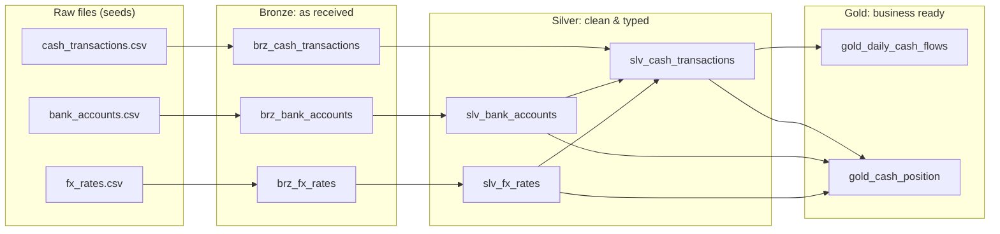

# Treasury Lakehouse with dbt & Databricks

A small end-to-end data pipeline for **corporate treasury data**, built with **dbt** on a
**medallion (bronze / silver / gold) architecture**. It runs on **Databricks** (Delta tables in
Unity Catalog) and, for local development and CI, on **DuckDB**.

The pipeline takes raw bank account, cash transaction and FX rate data, cleans it, converts
everything to EUR and produces two reporting tables: daily cash flows per entity and the
current cash position per bank account.

## Architecture



| Layer | Materialization | What happens |
|---|---|---|
| **Bronze** | views | Raw data exactly as delivered, all columns as text, plus a `_loaded_at` timestamp. |
| **Silver** | tables | Proper data types, trimmed and upper-cased currency codes, duplicate rows removed, entity added, amounts converted to EUR with the rate of the value date. |
| **Gold** | tables | `gold_daily_cash_flows`: inflows, outflows and net flow per day, entity and currency. `gold_cash_position`: opening balance + movements = closing balance per account, in local currency and EUR. |

On Databricks, every silver and gold table is created as a **Delta table** in Unity Catalog.

## Data quality

The raw data is intentionally imperfect, the way real source systems are:
duplicated transactions, a duplicated FX rate, and currency codes like `" usd "`.
The silver layer fixes these, and dbt tests make sure they stay fixed:

- **Generic tests**: `unique`, `not_null`, `accepted_values` (currencies, flow direction) and
  `relationships` (every transaction belongs to a known bank account).
- **Custom generic test** `unique_combination`: one FX rate per date and currency, one gold row
  per day/entity/currency.
- **Singular tests**:
  - `assert_fx_rates_positive`: no zero or negative FX rates.
  - `assert_gold_reconciles_with_silver`: total net flow in gold matches the transaction
    detail in silver to the cent (a typical treasury reconciliation control).
- A `not_null` test on `amount_eur` catches any transaction without an FX rate for its date.

## CI/CD

Every push and pull request runs `.github/workflows/ci.yml` on GitHub Actions:
it installs dbt, checks the project compiles (`dbt parse`) and runs `dbt build` on DuckDB,
which loads the seeds, builds all models and runs every test. A change that breaks a model
or a data-quality rule fails the pipeline before it reaches `main`.

## Project structure

```
├── .github/workflows/ci.yml     # CI: dbt build on every push / PR
├── dbt_project.yml              # layer configuration (schemas, materializations)
├── profiles.yml                 # connections: DuckDB (dev/CI) and Databricks
├── macros/
│   └── generate_schema_name.sql # one schema per layer: raw, bronze, silver, gold
├── models/
│   ├── bronze/                  # raw views
│   ├── silver/                  # cleaning, typing, dedup, FX conversion
│   └── gold/                    # reporting tables
├── seeds/                       # raw CSV files (synthetic data)
├── scripts/generate_data.py     # regenerates the synthetic data
└── tests/
    ├── generic/unique_combination.sql
    ├── assert_fx_rates_positive.sql
    └── assert_gold_reconciles_with_silver.sql
```

## How to run

### Locally (DuckDB)

```bash
python -m venv .venv && source .venv/bin/activate
pip install -r requirements.txt
dbt build                 # seeds + models + tests
dbt docs generate && dbt docs serve   # browse documentation and lineage graph
```

### On Databricks

1. In Databricks, open **SQL Warehouses**, pick your warehouse and copy the
   *Server hostname* and *HTTP path* from **Connection details**.
2. Create a personal access token (**Settings → Developer → Access tokens**).
3. Run:

```bash
pip install dbt-databricks
export DATABRICKS_HOST=<server-hostname>
export DATABRICKS_HTTP_PATH=<http-path>
export DATABRICKS_TOKEN=<token>
dbt build --target databricks
```

Tables are created in the `workspace` catalog under the `raw`, `bronze`, `silver` and `gold`
schemas.

## Data

All data is **synthetic**, generated by `scripts/generate_data.py` for a fictional group
(Alcora) with five bank accounts in EUR, GBP, USD and CHF, Q1 2026. FX rates follow the
ECB convention (1 EUR = X units of currency) and are a random walk around realistic levels.
